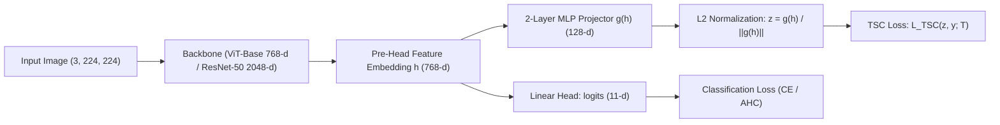

# Phase 4.2 Planning: Targeted Supervised Contrastive Learning (TSC)

## 1. Paper Provenance & Official Code Repository
- **Paper**: Li et al., *"Targeted Supervised Contrastive Learning for Long-Tailed Recognition"*, **CVPR 2022** (arXiv:2111.13998).
- **Official GitHub Repository**: [`https://github.com/LTH14/targeted-supcon`](https://github.com/LTH14/targeted-supcon)
- **Licence**: **MIT License** (Copyright (c) 2022 Tianhong Li).
- **Licence Approval**: Verified MIT License; permitted for academic research and code adaptation before incorporating into SkinCancerTracker.

---

## 2. Hypersphere Target Generation for $K=11$ Classes

### 2.1 The Geometric Objective
Standard Supervised Contrastive Learning (SupCon) creates contrastive pairs between randomly sampled instances in mini-batches. Under extreme class imbalance ($280.2 : 1$ in MILK10k), head classes (BCC, NV) dominate the batch, causing majority clusters to expand and squeeze minority classes (MAL_OTH, BEN_OTH) into tiny, poorly generalized peripheral regions.

TSC solves this by replacing instance-to-instance contrastive keys with a fixed, pre-computed set of mutually repulsive target anchors $\{\mathbf{t}_c\}_{c=0}^{K-1}$ on an $M$-dimensional unit hypersphere:
$$\mathbf{t}_c \in \mathbb{S}^{M-1} \subset \mathbb{R}^M, \quad \|\mathbf{t}_c\|_2 = 1$$

### 2.2 Uniformity Loss Formulation
Following `target_generation.py` in the official repository, targets are generated by minimizing the pairwise Gaussian potential (uniformity metric on the hypersphere):
$$\mathcal{L}_{\text{uniform}}(\mathbf{T}) = \frac{1}{K} \sum_{i=0}^{K-1} \log \left( \sum_{j=0}^{K-1} \exp\left( \frac{\mathbf{t}_i^\top \mathbf{t}_j}{t} \right) \right)$$
where:
- $\mathbf{T} \in \mathbb{R}^{K \times M}$ with each row normalized: $\mathbf{t}_i = \mathbf{T}_{i, :} / \|\mathbf{T}_{i, :}\|_2$.
- $t$ is the kernel bandwidth / temperature hyperparameter (default $t = 0.07$).
- $K = 11$ diagnostic classes.
- $M = 128$ feature projection dimension.

### 2.3 Optimization Procedure
1. Initialize $\mathbf{T}^{(0)} \sim \mathcal{N}(0, I) \in \mathbb{R}^{11 \times 128}$.
2. Optimize using Adam with learning rate $\eta = 10^{-3}$ over $N_{\text{iter}} = 2,000$ iterations.
3. At each step, project to the sphere: $\mathbf{T} \leftarrow \mathbf{T} / \|\mathbf{T}\|_2$.
4. For $K=11$ in $M=128$ dimensions, $M \gg K$, so the 11 vectors can be made nearly mutually orthogonal or form a regular simplex where pairwise dot products approach:
   $$\mathbf{t}_i^\top \mathbf{t}_j \approx -\frac{1}{K - 1} = -\frac{1}{10} = -0.10 \quad (\forall i \neq j)$$
5. Once generated, targets are saved and **strictly frozen** during model training.

---

## 3. Where the Loss Attaches to the Architecture

### 3.1 Pre-Head Embedding Layer
In the PanDerm Vision Transformer (or ResNet-50):

- The backbone produces feature representation $\mathbf{h} \in \mathbb{R}^{768}$ (ViT `[CLS]` token after LayerNorm).
- A 2-layer projection MLP $g(\mathbf{h}) = W_2 \text{GELU}(W_1 \mathbf{h})$ maps 768-d to $M=128$-d.
- The projection is $L_2$-normalized: $\hat{\mathbf{z}} = g(\mathbf{h}) / \|g(\mathbf{h})\|_2$.
- The TSC loss attaches directly to $\hat{\mathbf{z}}$.
- The classification head attaches to $\mathbf{h}$ (or simultaneously optimized).

---

## 4. Mathematical Loss Definition Exactly as in the Paper

For an anchor image $i$ with label $y_i$ and normalized embedding $\hat{\mathbf{z}}_i$:
$$\mathcal{L}_{\text{TSC}}(\hat{\mathbf{z}}_i, y_i) = -\log \frac{\exp\left(\frac{\hat{\mathbf{z}}_i^\top \mathbf{t}_{y_i}}{\tau}\right)}{\sum_{c=0}^{K-1} \exp\left(\frac{\hat{\mathbf{z}}_i^\top \mathbf{t}_c}{\tau}\right)}$$

Where:
- $\hat{\mathbf{z}}_i \in \mathbb{R}^M$ is the $L_2$-normalized representation of sample $i$.
- $\mathbf{t}_{y_i}$ is the pre-computed uniform target vector for ground-truth class $y_i$.
- $\mathbf{t}_c$ represents target vectors for all classes $c \in \{0, \dots, K-1\}$.
- $\tau$ is the contrastive temperature (default $\tau = 0.1$).

In a mini-batch of size $B$, the batch loss is:
$$\mathcal{L}_{\text{TSC}} = \frac{1}{B} \sum_{i=1}^B \mathcal{L}_{\text{TSC}}(\hat{\mathbf{z}}_i, y_i)$$

When combined with primary classification loss (e.g., Cross-Entropy or Asymmetric Hierarchical Cost):
$$\mathcal{L}_{\text{joint}} = \mathcal{L}_{\text{task}} + \lambda_{\text{TSC}} \mathcal{L}_{\text{TSC}}$$

---

## 5. Hyperparameter Specifications

| Hyperparameter | Symbol | Value in Paper / Repo | Proposed Value for SkinCancerTracker | Rationale |
| :--- | :---: | :---: | :---: | :--- |
| Embedding Dimension | $M$ | 128 | 128 | Standard contrastive projection dimension |
| Target Temp | $t$ | 0.07 | 0.07 | Uniformity kernel bandwidth |
| Loss Temp | $\tau$ | 0.07 / 0.1 | 0.1 | Softmax scale for target similarity |
| Loss Weight | $\lambda_{\text{TSC}}$ | 1.0 | Sweep $\{0.1, 0.5, 1.0\}$ | Balances representation shaping vs classification |
| Target Iterations | $N_{\text{iter}}$ | 10,000 | 2,000 | For $K=11$, converges in $<1,000$ iterations |

---

## 6. What Is Uncertain & Research Risks

1. **Target-to-Class Assignment (Hungarian Matching vs Fixed Binding)**:
   - In MoCo pretraining on ImageNet-LT ($K=1000$), Li et al. dynamically assign targets to moving class centroids using the Hungarian algorithm (`linear_sum_assignment`).
   - For $K=11$ in supervised fine-tuning from a foundation model (PanDerm), dynamic assignment can shuffle target roles across epochs, destabilizing classification. A fixed, deterministic binding (or initialized from pre-trained class centroids) is more stable for supervised transfer.
2. **Pretraining vs Joint Training**:
   - The paper uses a 2-stage protocol: Stage 1 = MoCo + TSC pretraining (freezing linear classifier); Stage 2 = linear probing.
   - For PanDerm, the backbone is *already* pretrained on dermatology. Running 200 epochs of self-supervised TSC from scratch would discard PanDerm's clinical feature representations. Therefore, a **joint fine-tuning objective** ($\mathcal{L}_{\text{CE}} + \lambda \mathcal{L}_{\text{TSC}}$) is scientifically appropriate and computationally viable on Kaggle.
3. **Hypersphere Geometry vs Hierarchical Costs**:
   - Standard TSC assumes all classes are mutually equidistant (uniform sphere). However, in Phase 4.1, we established that Malignant classes should have higher separation from Benign classes than intra-class pairs. Reconciling spherical uniformity with asymmetric hierarchical clinical costs is a novel research question for Phase 4.2.
