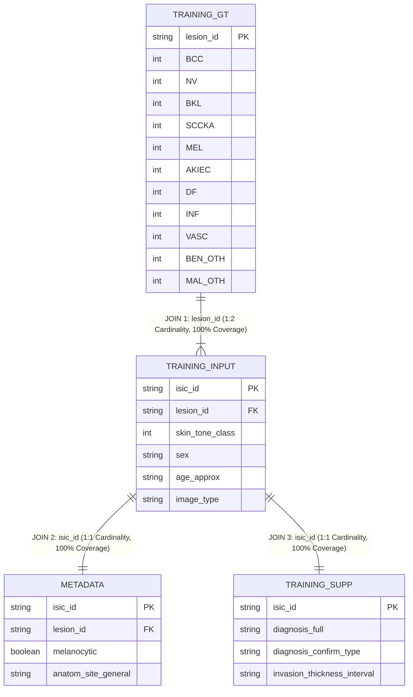

# Dataset Analysis & Preprocessing Mathematics

**Author**: Senior Machine Learning Engineering & Research Science Reference  
**Project**: SkinCancerTracker / DermaAI  
**Target Audience**: B.Tech CSE / AI Researchers, Faculty Evaluators, Technical Interviewers  
**Specification Version**: Phase 1 & Phase 2 Technical Baseline  

---

## 1. Master Dataset Identity & Overview

| Attribute | Specification Details |
| :--- | :--- |
| **Dataset Identifier** | `milk10k_multimodal` (ISIC Multimodal Dermatology Benchmark) |
| **Local Source Path** | `C:\Users\prtv1\OneDrive\Attachments\Desktop\Dermatology\milk10k` |
| **Active Project Directory** | `data/` (mirrored tables and splits) |
| **Physical Image Directory** | `data/images/` |
| **Total Physical Images** | **$10,480$** JPEG files |
| **Total Unique Lesions** | **$5,240$** patient lesion clusters |
| **Image-to-Lesion Ratio** | Exactly **$2.00$** images per lesion across the complete dataset |
| **Diagnostic Classes ($K$)** | **$11$** mutually exclusive classes |
| **Demographic Fairness Annotation** | `skin_tone_class` (MILK10k integer categories 0 through 5; 0 = very dark, 5 = very light) |
| **Clinical Biomarkers** | 7 MONET concept markers (ulceration, hair, vessels, erythema, pigment, fluid, pen ink) |

---

## 2. Table Schemas and Relational Architecture

The dataset is organized across four relational CSV tables in `data/`:

### 2.1 Table Specifications
1. **`training_input.csv`** ($10,480$ rows $\times 17$ columns):
   - **Primary Key**: `isic_id` (string, unique image identifier, e.g. `ISIC_0012345`).
   - **Grouping Key**: `lesion_id` (string, patient lesion cluster identifier, e.g. `IL_0001234`).
   - **Demographic Columns**: `age_approx` (float/int), `sex` (categorical: `male`, `female`), `site` (anatomical location).
   - **Fairness Subgroup**: `skin_tone_class` (integer categories $0$ to $5$).
   - **Technical Metadata**: `image_type` (`dermoscopic`, `clinical overview`), `image_manipulation`.
   - **Biomarkers**: `MONET_ulceration_crust`, `MONET_hair`, `MONET_vasculature_vessels`, `MONET_erythema`, `MONET_pigmented`, `MONET_gel_water_drop_fluid_dermoscopy_liquid`, `MONET_skin_markings_pen_ink_purple_pen`.

2. **`training_gt.csv`** ($5,240$ rows $\times 12$ columns):
   - **Primary Key**: `lesion_id` (one record per unique lesion).
   - **Diagnostic Targets**: $11$ one-hot binary columns ($\in \{0, 1\}$): `AKIEC`, `BCC`, `BEN_OTH`, `BKL`, `DF`, `INF`, `MAL_OTH`, `MEL`, `NV`, `SCCKA`, `VASC`.

3. **`metadata.csv`** ($10,480$ rows $\times 17$ columns):
   - Clinical metadata table keyed by `isic_id`. Contains `melanocytic` (boolean), `anatom_site_general`, `anatom_site_special`, `concomitant_biopsy`, and hierarchical diagnostic codes (`diagnosis_1` to `diagnosis_4`).

4. **`training_supp.csv`** ($10,480$ rows $\times 4$ columns):
   - Diagnostic verification table keyed by `isic_id`. Contains `diagnosis_full` (detailed pathology string), `diagnosis_confirm_type` (`histopathology`, `single image expert consensus`, etc.), and `invasion_thickness_interval`.

---

## 3. Class Distribution and Imbalance Mathematics

### 3.1 Empirical Diagnostic Distribution
Extracted directly from `training_gt.csv` across the $5,240$ unique lesions (and corresponding $10,480$ images):

| Class | Full Diagnostic Pathology | Image Count | Percentage | Unique Lesions | Lesion Pct | Clinical Urgency |
| :--- | :--- | :--- | :--- | :--- | :--- | :--- |
| **BCC** | Basal Cell Carcinoma | $5,044$ | $48.13\%$ | $2,522$ | $48.13\%$ | Malignant (Common non-melanoma) |
| **NV** | Melanocytic Nevus (Mole) | $1,492$ | $14.24\%$ | $746$ | $14.24\%$ | Benign |
| **BKL** | Benign Keratosis (Seborrheic) | $1,088$ | $10.38\%$ | $544$ | $10.38\%$ | Benign |
| **SCCKA** | Squamous Cell Carcinoma / KA | $946$ | $9.03\%$ | $473$ | $9.03\%$ | Malignant (Invasive risk) |
| **MEL** | Invasive Cutaneous Melanoma | $900$ | $8.59\%$ | $450$ | $8.59\%$ | **Critical Malignancy** |
| **AKIEC** | Actinic Keratosis / Bowen's | $606$ | $5.78\%$ | $303$ | $5.78\%$ | Pre-malignant |
| **DF** | Dermatofibroma | $104$ | $0.99\%$ | $52$ | $0.99\%$ | Benign rare |
| **INF** | Inflammatory Dermatosis | $100$ | $0.95\%$ | $50$ | $0.95\%$ | Non-neoplastic |
| **VASC** | Vascular Lesion (Hemangioma) | $94$ | $0.90\%$ | $47$ | $0.90\%$ | Benign |
| **BEN_OTH**| Benign Other | $88$ | $0.84\%$ | $44$ | $0.84\%$ | Benign unclassified |
| **MAL_OTH**| Malignant Other | $18$ | $0.17\%$ | $9$ | $0.17\%$ | Rare malignancy |
| **Total** | *All 11 Classes* | **$10,480$** | **$100.00\%$** | **$5,240$** | **$100.00\%$** | — |

### 3.2 Mathematical Formulation of Class Imbalance
The Class Imbalance Ratio $\rho$ is defined as the quotient between the majority class support $N_{\max}$ and the minority class support $N_{\min}$:

$$\rho = \frac{N_{\max}}{N_{\min}} = \frac{N_{\text{BCC}}}{N_{\text{MAL\_OTH}}} = \frac{2,522}{9} \approx 280.22$$

#### Impact on Machine Learning Optimization
1. **Majority Gradient Dominance**: When using standard Empirical Risk Minimization (ERM) with unweighted cross-entropy loss:
   $$\mathcal{L}_{ERM}(\theta) = \frac{1}{N} \sum_{i=1}^N \mathcal{L}(f(x_i; \theta), y_i)$$
   The gradient $\nabla_\theta \mathcal{L}_{ERM}$ is composed of $48.13\%$ BCC sample updates and only $0.17\%$ MAL_OTH sample updates. The optimization trajectory trivially collapses into predicting BCC for ambiguous features, driving minority recall to near zero.
2. **Pathological Accuracy Trap**: A trivial model predicting BCC for all lesions achieves:
   $$\text{Accuracy}_{\text{dummy}} = 48.13\%$$
   Yet this dummy model has an effective sensitivity of $0.00\%$ on deadly Melanoma (`MEL`), which is a catastrophic clinical failure.

---

## 4. Skin-Tone Demographic Distribution & Algorithmic Fairness

### 4.1 Empirical Subgroup Counts
In the MILK10k dataset, skin tone is recorded under the metadata variable `skin_tone_class`.

Per the official ISIC Archive definition for MILK10k (Collection 425: [`https://api.isic-archive.com/api/v2/collections/425/`](https://api.isic-archive.com/api/v2/collections/425/) and Collection 424: [`https://api.isic-archive.com/api/v2/collections/424/`](https://api.isic-archive.com/api/v2/collections/424/); also hosted at [`https://challenge.isic-archive.com/`](https://challenge.isic-archive.com/)):

> *"Skin tone is categorized into six levels, ranging from very dark (0) to very light (5), intentionally distinct from the Fitzpatrick skin types to avoid confusion. Most patients had skin tones in the middle ranges."*

Only the endpoints of this scale are defined by the source: **Class 0 = very dark** and **Class 5 = very light**. Intermediate classes (1, 2, 3, 4) represent ordinal gradations without descriptive textual labels in the official metadata.

> [!IMPORTANT]
> `skin_tone_class` is **not** the Fitzpatrick scale. It was intentionally constructed by the dataset creators to be distinct from Fitzpatrick phototypes (which run in the opposite direction, from Type I = very light to Type VI = very dark) to avoid clinical ambiguity and standardize multi-institutional annotations.
> 
> *Correction Note*: An earlier version of this table mixed up units (reporting total paired image counts, $N=10,480$, rather than unique lesion counts) and inverted the scale direction by incorrectly mapping classes 0-5 to Fitzpatrick phototypes (labeling 0 as "Unpigmented/Albinism" and 5 as "Dark Brown/Black"). The table below replaces that tabulation with the verified per-split **lesion counts** from [`results/audit/skin_tone_splits.md`](../../results/audit/skin_tone_splits.md).

#### Verified Per-Split Lesion Distribution ($N=5,240$ unique lesions)

Each unique lesion has identical skin tone across paired clinical & dermoscopic modalities. Because baseline experiments evaluate on single-modality dermoscopic images (1 image per lesion), the unique lesion counts below correspond exactly to the evaluation sample sizes in each split:

| `skin_tone_class` | Official Definition | Train (Lesions) | Validation (Lesions) | Test (Lesions) | Total (All Splits) |
|:---:|:---:|:---:|:---:|:---:|:---:|
| **Class 0** | very dark | 2 | 4 | 0 | 6 |
| **Class 1** | — | 82 | 11 | 12 | 105 |
| **Class 2** | — | 358 | 76 | 72 | 506 |
| **Class 3** | — | 2,198 | 490 | 486 | 3,174 |
| **Class 4** | — | 754 | 159 | 153 | 1,066 |
| **Class 5** | very light | 274 | 46 | 63 | 383 |
| **NULL / Missing** | — | 0 | 0 | 0 | 0 |
| **Total** | — | **3,668** | **786** | **786** | **5,240** |

*(Note: In the held-out test split $N=786$, Class 0 has $n=0$ lesions; the evaluated subgroups are Tone 1: 12, Tone 2: 72, Tone 3: 486, Tone 4: 153, Tone 5: 63. Total paired image counts across the entire dataset are exactly $2 \times$ the lesion figures: Class 0: 12, Class 1: 210, Class 2: 1,012, Class 3: 6,348, Class 4: 2,132, Class 5: 766, Total: 10,480 images).*

### 4.2 Mathematical Fairness Disparity Metrics
To quantitatively evaluate algorithmic fairness, the pipeline computes the demographic performance disparity across subgroup slices $g \in \mathcal{G}$:

$$\Delta_{\text{Acc}} = \max_{g \in \mathcal{G}^*} \text{Acc}(g) - \min_{g \in \mathcal{G}^*} \text{Acc}(g)$$

$$\Delta_{\text{BalAcc}} = \max_{g \in \mathcal{G}^*} \text{BalAcc}(g) - \min_{g \in \mathcal{G}^*} \text{BalAcc}(g)$$

Where $\mathcal{G}^* = \{g \in \mathcal{G} \mid N_g \ge 10\}$ enforces a minimum sample support threshold ($N_g \ge 10$) in [`src/eval/metrics.py`](file:///C:/Users/prtv1/OneDrive/Attachments/Desktop/SkinCancerTracker/src/eval/metrics.py#L136-L142) to prevent small-denominator variance anomalies from skewing disparity reports.

---

## 5. Lesion-Level Data Partitioning (Leakage Prevention)

### 5.1 The Clinical Data Leakage Problem
In dermatological imaging, the same patient lesion is routinely photographed multiple times:
- Under polarized and non-polarized dermoscopy
- Macro clinical overview and dermatoscopic magnification
- Different illumination angles or longitudinal clinical follow-up

If a standard naive image-level random split is executed ($70\%$ train, $30\%$ test):
Let $\mathcal{I}_l = \{i_{l, 1}, i_{l, 2}\}$ be the two images associated with lesion $l$.
The probability that both images are assigned to the training set is $0.7 \times 0.7 = 0.49$.
The probability that image 1 is assigned to train and image 2 is assigned to test is:

$$P(\text{leakage for lesion } l) = 2 \times (0.7 \times 0.15) = 0.21$$

Across $5,240$ lesions, approximately $1,100$ lesions would have identical patient features (background skin pigmentation, hair patterns, surgical skin markings, skin texture) split across training and test sets.
The model would memorize patient-specific visual fingerprints rather than learning pathological lesion features. On unseen patient lesions in clinical practice, performance plummets catastrophically.

### 5.2 Two-Stage GroupShuffleSplit Algorithm
To guarantee mathematical isolation, [`src/data/splitting.py`](file:///C:/Users/prtv1/OneDrive/Attachments/Desktop/SkinCancerTracker/src/data/splitting.py#L107-L128) implements a two-stage grouped split:

1. **Stage 1 (Test Isolation)**:
   GroupShuffleSplit partitions unique lesions into $(\text{Train} \cup \text{Val})$ and $\text{Test}$ with test ratio $r_{\text{test}} = 0.15$:
   $$\mathcal{L}_{\text{test}} \subset \mathcal{L}, \quad \frac{|\mathcal{L}_{\text{test}}|}{|\mathcal{L}|} = 0.15, \quad \mathcal{L}_{\text{train\_val}} = \mathcal{L} \setminus \mathcal{L}_{\text{test}}$$

2. **Stage 2 (Validation Isolation)**:
   The relative validation ratio within the remaining pool is computed as:
   $$r_{\text{val\_rel}} = \frac{r_{\text{val}}}{r_{\text{train}} + r_{\text{val}}} = \frac{0.15}{0.70 + 0.15} = \frac{0.15}{0.85} \approx 0.17647$$
   A second GroupShuffleSplit partitions $\mathcal{L}_{\text{train\_val}}$ into $\mathcal{L}_{\text{val}}$ and $\mathcal{L}_{\text{train}}$.

3. **Disjointness Theorem & Verification**:
   The split guarantees complete pairwise disjointness:
   $$\mathcal{L}_{\text{train}} \cap \mathcal{L}_{\text{val}} = \emptyset, \quad \mathcal{L}_{\text{train}} \cap \mathcal{L}_{\text{test}} = \emptyset, \quad \mathcal{L}_{\text{val}} \cap \mathcal{L}_{\text{test}} = \emptyset$$

### 5.3 Actual Verified Split Cardinality
From [`data/splits/split_summary.json`](file:///C:/Users/prtv1/OneDrive/Attachments/Desktop/SkinCancerTracker/data/splits/split_summary.json):

| Partition | Unique Lesions | Lesion Proportion | Total Images | Image Proportion | Verified Leakage |
| :--- | :--- | :--- | :--- | :--- | :--- |
| **Train** | $3,668$ | $70.00\%$ | $7,336$ | $70.00\%$ | $0$ lesions shared |
| **Validation** | $786$ | $15.00\%$ | $1,572$ | $15.00\%$ | $0$ lesions shared |
| **Test** | $786$ | $15.00\%$ | $1,572$ | $15.00\%$ | $0$ lesions shared |
| **Total** | **$5,240$** | **$100.00\%$** | **$10,480$** | **$100.00\%$** | **Strictly Disjoint** |

---

## 6. Preprocessing and Augmentation Pipelines

The repository provides two separate transformation pipelines in [`src/data/transforms.py`](file:///C:/Users/prtv1/OneDrive/Attachments/Desktop/SkinCancerTracker/src/data/transforms.py):

### 6.1 Baseline CNN Pipeline (Exp-1)
- **Input Dimensions**: Resized directly to $224 \times 224$ pixels.
- **Normalization Constants** (Standard ImageNet):
  $$\mu = [0.485, 0.456, 0.406], \quad \sigma = [0.229, 0.224, 0.225]$$
- **Training Augmentations**:
  1. `Resize((224, 224))`
  2. `RandomHorizontalFlip(p=0.5)`
  3. `RandomVerticalFlip(p=0.5)`
  4. `RandomRotation(degrees=30)` (affine invariance)
  5. `ColorJitter(brightness=0.1, contrast=0.1, saturation=0.1)` (dermatoscopic lighting robustness)
  6. `ToTensor()` (maps $[0, 255] \to [0.0, 1.0]$)
  7. `Normalize(mean, std)`

### 6.2 Official PanDerm Pipeline (Exp-2)
- **Input Dimensions**: High-resolution resize to $256 \times 256$, followed by random crop to $224 \times 224$.
- **Normalization Constants** (Official PanDerm Pretraining):
  $$\mu = [0.485, 0.456, 0.406], \quad \sigma = [0.228, 0.224, 0.225]$$
  *(Note: $\sigma_{\text{green}} = 0.228$ rather than $0.229$ per upstream Nature Medicine publication).*
- **Training Augmentations**:
  1. `Resize(256)`
  2. `RandomResizedCrop(224, scale=(0.75, 1.0))` (scale jittering)
  3. `RandomHorizontalFlip(p=0.5)`
  4. `RandomVerticalFlip(p=0.5)`
  5. `RandomRotation(degrees=45)`
  6. `ColorJitter(hue=0.2)` (lesion pigment chromophore invariance)
  7. `ToTensor()`
  8. `Normalize(mean, std)`

---

## 7. Comparative Reference: External Dermatology Datasets

The repository references two primary external dermatology benchmarks within `external/panderm` and `external/dermfm-zero`:

1. **HAM10000 (Human Against Machine with 10,000 training images)**:
   - 10,015 dermoscopic images collected from ViDIR Group (Medical University of Vienna) and Cliff Rosendahl (Queensland).
   - 7 diagnostic categories: MEL, NV, BCC, AKIEC, BKL, DF, VASC.
   - Lesion-level data splitting is also critical due to multiple lesion acquisitions.
2. **PAD-UFES-20 (Dermatology Mobile Phone Dataset)**:
   - 2,298 clinical smartphone images collected at the Federal University of Espírito Santo (UFES), Brazil.
   - 6 diagnostic categories: BCC, SCC, MEL, ACK (Actinic Keratosis), SEK (Seborrheic Keratosis), NEV (Nevus).
   - Contains explicit Fitzpatrick phototype annotations (I to VI), making it a gold standard for fairness evaluation.
