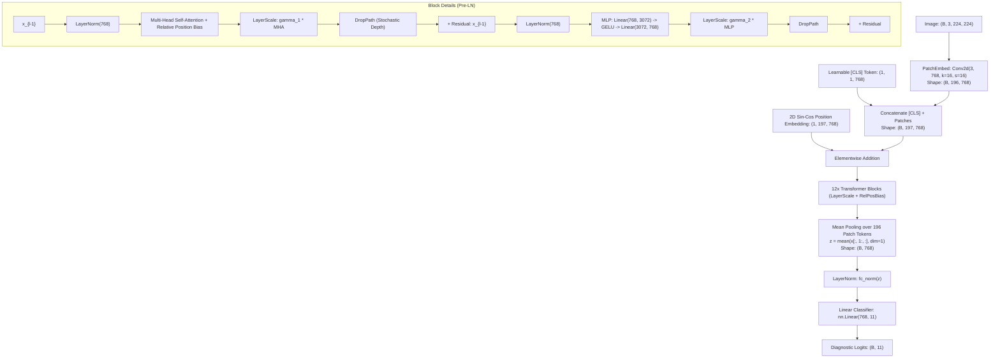

# Deep Learning Model Architecture Mathematics

**Author**: Senior Machine Learning Engineering & Research Science Reference  
**Project**: SkinCancerTracker / DermaAI  
**Target Audience**: B.Tech CSE / AI Researchers, Faculty Evaluators, Technical Interviewers  
**Specification Version**: Phase 1 & Phase 2 Technical Baseline  

---

## 1. Architectural Scope & Taxonomy

SkinCancerTracker implements a modular factory pattern ([`src/models/factory.py`](file:///C:/Users/prtv1/OneDrive/Attachments/Desktop/SkinCancerTracker/src/models/factory.py)) that instantiates two primary architectures for comparative clinical benchmarking:
1. **Exp-1: Standard CNN Baseline (`resnet50`)** — 50-layer deep residual network with Bottleneck residual units.
2. **Exp-2: Foundation Vision Transformer (`panderm_base`)** — Pretrained foundation Vision Transformer (*Nature Medicine* 2025) featuring Relative Position Bias, 2D Sin-Cos Position Embeddings, LayerScale, and Mean Pooling.
3. *Auxiliary Baselines supported in code*: `resnet18`, `resnet34`, `efficientnet_b0`.

---

## 2. Model 1: ResNet-50 Baseline Architecture (Exp-1)

### 2.1 Specification Overview
- **Implementation File**: [`src/models/baseline.py`](file:///C:/Users/prtv1/OneDrive/Attachments/Desktop/SkinCancerTracker/src/models/baseline.py#L14-L62)
- **Input Tensor**: $(B, 3, 224, 224)$
- **Output Tensor**: $(B, 11)$ raw diagnostic logits
- **Total Parameters**: $\approx 23,530,571$ (23.5M parameters)
- **Modifications**: Replaced ImageNet 1000-class fully connected layer with `nn.Sequential(nn.Dropout(p=0.2), nn.Linear(2048, 11))`.

### 2.2 Mathematical Operations in ResNet-50

#### 1. 2D Cross-Correlation (Convolution)
For input feature map $X \in \mathbb{R}^{C_{\text{in}} \times H \times W}$ and kernel $W \in \mathbb{R}^{C_{\text{out}} \times C_{\text{in}} \times K_h \times K_w}$:
$$(X * W)_{c_{\text{out}}, i, j} = \sum_{c_{\text{in}}=0}^{C_{\text{in}}-1} \sum_{u=0}^{K_h-1} \sum_{v=0}^{K_w-1} X_{c_{\text{in}}, i \cdot s + u, j \cdot s + v} \cdot W_{c_{\text{out}}, c_{\text{in}}, u, v}$$

#### 2. Bottleneck Residual Unit
A ResNet-50 Bottleneck block consists of three stacked convolutions: $1\times 1$ projection (dimension reduction), $3\times 3$ spatial convolution, and $1\times 1$ expansion:
$$\mathcal{F}(x) = W_3 * \sigma\Big( \text{BN}\big( W_2 * \sigma( \text{BN}( W_1 * x ) ) \big) \Big)$$
$$y = \sigma\Big( \mathcal{F}(x) + \mathcal{W}_s(x) \Big)$$
where $\mathcal{W}_s(x) = x$ when spatial and channel dimensions match (identity shortcut), or a $1\times 1$ convolution with stride 2 when downsampling (projection shortcut).

### 2.3 Layer-by-Layer Architecture Table: ResNet-50

| Stage / Layer | Input Shape $(C \times H \times W)$ | Operation / Kernel | Mathematical Formula | Output Shape | Receptive Field & Purpose |
| :--- | :--- | :--- | :--- | :--- | :--- |
| **Input** | $3 \times 224 \times 224$ | Raw RGB Tensor | $X$ | $3 \times 224 \times 224$ | Normalized dermoscopic image |
| **Stem Conv** | $3 \times 224 \times 224$ | Conv2d $7\times 7$, stride 2, pad 3 | $X * W_{7\times 7}$ | $64 \times 112 \times 112$ | Coarse spatial feature extraction |
| **Stem BN + Act**| $64 \times 112 \times 112$ | BatchNorm2d + ReLU | $\max(0, \text{BN}(x))$ | $64 \times 112 \times 112$ | Standardizes activations, non-linearity |
| **Stem MaxPool** | $64 \times 112 \times 112$ | MaxPool2d $3\times 3$, stride 2, pad 1 | $\max_{(u, v)} x_{i+u, j+v}$ | $64 \times 56 \times 56$ | Spatial downsampling |
| **Layer 1** (conv2_x) | $64 \times 56 \times 56$ | $3\times$ Bottleneck Blocks: $[1\times 1, 64; 3\times 3, 64; 1\times 1, 256]$ | $y = x + \mathcal{F}(x)$ | $256 \times 56 \times 56$ | Low-level texture & edge extraction |
| **Layer 2** (conv3_x) | $256 \times 56 \times 56$ | $4\times$ Bottleneck Blocks: $[1\times 1, 128; 3\times 3, 128; 1\times 1, 512]$, stride 2 | $y = \mathcal{W}_s(x) + \mathcal{F}(x)$ | $512 \times 28 \times 28$ | Mid-level dermatological pattern mining |
| **Layer 3** (conv4_x) | $512 \times 28 \times 28$ | $6\times$ Bottleneck Blocks: $[1\times 1, 256; 3\times 3, 256; 1\times 1, 1024]$, stride 2 | $y = \mathcal{W}_s(x) + \mathcal{F}(x)$ | $1024 \times 14 \times 14$ | Pigment networks & vascular patterns |
| **Layer 4** (conv5_x) | $1024 \times 14 \times 14$| $3\times$ Bottleneck Blocks: $[1\times 1, 512; 3\times 3, 512; 1\times 1, 2048]$, stride 2 | $y = \mathcal{W}_s(x) + \mathcal{F}(x)$ | $2048 \times 7 \times 7$ | High-level lesion morphology & borders |
| **Global Pool**| $2048 \times 7 \times 7$ | AdaptiveAvgPool2d(1, 1) | $\frac{1}{49} \sum_{i=1}^7 \sum_{j=1}^7 x_{c, i, j}$ | $2048 \times 1 \times 1$ | Spatial collapse into latent vector |
| **Flatten** | $2048 \times 1 \times 1$ | Flatten(1) | $x \in \mathbb{R}^{2048}$ | $2048$ | Vector representation |
| **Dropout** | $2048$ | Dropout(p=0.2) | $x \cdot \frac{m}{1-p}, m \sim \text{Bernoulli}(1-p)$ | $2048$ | Regularization against overfitting |
| **Classification Head**| $2048$ | Linear(2048, 11) | $z = W x + b$ | $11$ | Unnormalized diagnostic class logits |

---

## 3. Model 2: PanDerm Vision Transformer (Exp-2)

### 3.1 Specification Overview
- **Implementation File**: [`src/models/panderm.py`](file:///C:/Users/prtv1/OneDrive/Attachments/Desktop/SkinCancerTracker/src/models/panderm.py#L20-L147), [`external/panderm/classification/models/modeling_finetune.py`](file:///C:/Users/prtv1/OneDrive/Attachments/Desktop/SkinCancerTracker/external/panderm/classification/models/modeling_finetune.py#L381-L533)
- **Input Tensor**: $(B, 3, 224, 224)$
- **Patch Resolution**: $P = 16 \times 16 \implies N = (224/16) \times (224/16) = 14 \times 14 = 196$ patch tokens
- **Sequence Length**: $N + 1 = 197$ tokens (196 patch tokens + 1 class token)
- **Hidden Embedding Dimension ($d$)**: $768$ (Base), $1024$ (Large)
- **Transformer Depth ($L$)**: $12$ blocks (Base), $24$ blocks (Large)
- **Attention Heads ($h$)**: $12$ heads (Base, $d_k = 64$), $16$ heads (Large, $d_k = 64$)
- **MLP Expansion Ratio**: $4.0 \implies d_{\text{mlp}} = 4 \times 768 = 3,072$
- **Total Parameters**: $\approx 86.6 \times 10^6$ (Base), $\approx 304 \times 10^6$ (Large)

### 3.2 Architectural Flow & Mathematical Formulations

### 3.3 Layer-by-Layer Architecture Table: PanDerm Base

| Stage / Component | Input Shape | Mathematical Operation | Formulation | Output Shape | Specific Role |
| :--- | :--- | :--- | :--- | :--- | :--- |
| **Input Image** | $(B, 3, 224, 224)$ | Raw RGB Tensor | $X$ | $(B, 3, 224, 224)$ | Normalized dermoscopy input |
| **Patch Embedding** | $(B, 3, 224, 224)$ | Conv2d(3, 768, kernel=16, stride=16) | $X_p = \text{flatten}(\text{Conv2d}(X))$ | $(B, 196, 768)$ | Non-overlapping $16\times 16$ patch projection |
| **Class Token Prepend**| $(B, 196, 768)$ | Prepend learnable vector $x_{\text{cls}}$ | $X_0 = [x_{\text{cls}} \,\|\, X_p]$ | $(B, 197, 768)$ | Standard ViT representation token |
| **2D Sin-Cos PE** | $(B, 197, 768)$ | Static 2D harmonic coordinate embedding | $X_0 \leftarrow X_0 + \text{PE}_{2D}$ | $(B, 197, 768)$ | Injects 2D spatial coordinates |
| **Encoder Block $l$** | $(B, 197, 768)$ | Pre-LayerNorm | $\hat{X} = \text{LayerNorm}(X_{l-1})$ | $(B, 197, 768)$ | Stabilizes attention inputs |
| **Self-Attention** | $(B, 197, 768)$ | Scaled Dot-Product Attention with RelPosBias | $\text{Attn} = \text{softmax}\left(\frac{QK^T}{\sqrt{64}} + B_{\text{rel}}\right)V$ | $(B, 197, 768)$ | Global pairwise patch correlation |
| **LayerScale 1** | $(B, 197, 768)$ | Elementwise vector multiplication | $\gamma_{1, l} \odot \text{Attn}$ | $(B, 197, 768)$ | Scaled by $\gamma_1^{(0)} = 0.1$ |
| **DropPath 1** | $(B, 197, 768)$ | Stochastic Depth | $\text{DropPath}(x, p = \frac{l}{L} \cdot 0.1)$ | $(B, 197, 768)$ | Structural regularizer |
| **Residual 1** | $(B, 197, 768)$ | Skip Connection | $X_l' = X_{l-1} + \text{DropPath}(\dots)$ | $(B, 197, 768)$ | Unimpeded gradient highway |
| **MLP Block** | $(B, 197, 768)$ | Feed-Forward Network: $768 \to 3072 \to 768$ | $W_2 \cdot \text{GELU}(W_1 \hat{X}' + b_1) + b_2$ | $(B, 197, 768)$ | Non-linear channel mixing |
| **LayerScale 2** | $(B, 197, 768)$ | Elementwise vector multiplication | $\gamma_{2, l} \odot \text{MLP}$ | $(B, 197, 768)$ | Scaled by $\gamma_2^{(0)} = 0.1$ |
| **Residual 2** | $(B, 197, 768)$ | Skip Connection | $X_l = X_l' + \text{DropPath}(\dots)$ | $(B, 197, 768)$ | Preserves identity mapping |
| **Mean Pooling** | $(B, 197, 768)$ | Global token average over 196 patch tokens | $z = \frac{1}{196} \sum_{i=1}^{196} X_{L, i}$ | $(B, 768)$ | Aggregates full lesion spatial context |
| **Final LayerNorm** | $(B, 768)$ | LayerNorm(768, eps=1e-6) | $\bar{z} = \text{fc\_norm}(z)$ | $(B, 768)$ | Feature calibration before classification |
| **Classification Head**| $(B, 768)$ | Linear(768, 11) | $\hat{y} = W \bar{z} + b$ | $(B, 11)$ | 11 diagnostic class logits |

---

## 4. Key Architectural Innovations in PanDerm vs Standard ViT

1. **Relative Position Bias ($B_{\text{rel}}$)**:
   Standard ViT (Dosovitskiy et al.) relies solely on absolute positional embeddings added at layer 0. PanDerm adds a continuous relative position bias to every self-attention layer. For tokens at coordinates $(x_i, y_i)$ and $(x_j, y_j)$, the bias depends on the spatial displacement vector $(\Delta x, \Delta y) = (x_i - x_j, y_i - y_j)$. This provides translational equivariance, crucial for skin lesions that appear at arbitrary locations within the field of view.

2. **LayerScale ($\gamma$)**:
   In deep transformers, signals can grow exponentially. LayerScale introduces per-channel learnable multiplier vectors $\gamma_1, \gamma_2 \in \mathbb{R}^d$ initialized to $0.1$. This ensures blocks begin almost as identity mappings, dramatically improving fine-tuning stability.

3. **Mean Pooling vs [CLS] Token**:
   While classical ViT relies on the single $[CLS]$ token for classification, PanDerm sets `use_mean_pooling=True`, taking the mean of all 196 patch tokens:
   $$z = \frac{1}{N} \sum_{i=1}^{196} x_i$$
   In dermatology, lesion features (e.g. peripheral pigment networks, central ulceration, border irregularity) span multiple spatial quadrants. Mean pooling forces the model to retain distributed spatial information rather than bottlenecking through a single token.
