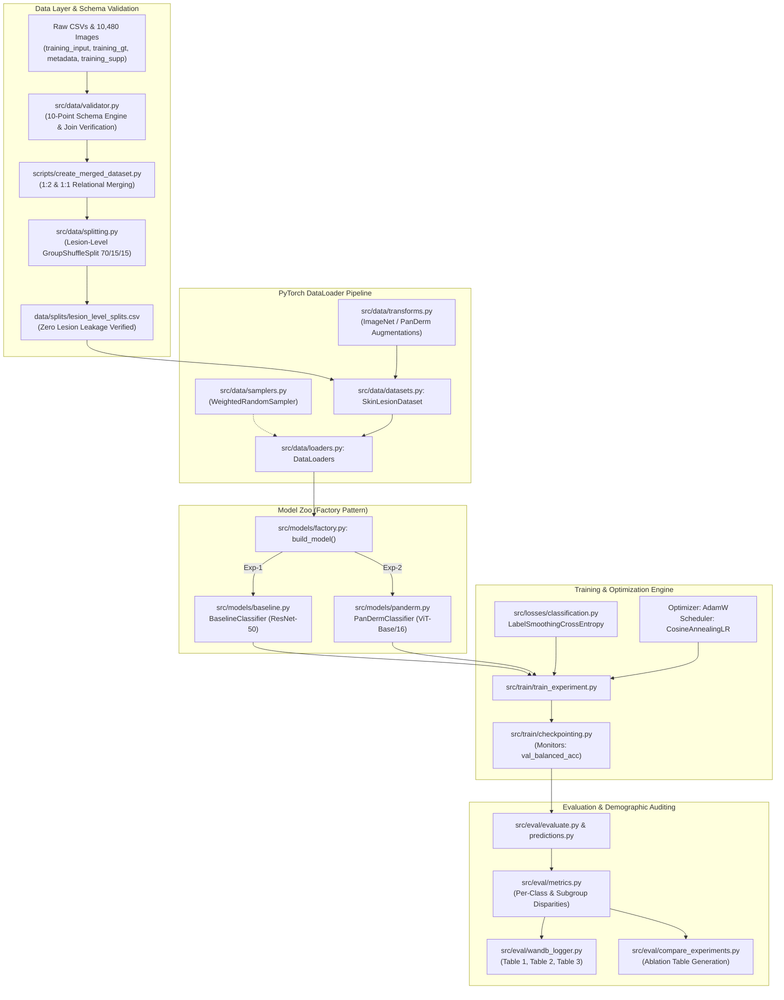

# SkinCancerTracker / DermaAI — Project Technical Overview & Master Architecture Reference

**Author**: Senior Machine Learning Engineering & Research Science Reference  
**Project**: SkinCancerTracker / DermaAI  
**Target Audience**: B.Tech CSE / AI Researchers, Faculty Evaluators, Technical Interviewers  
**Specification Version**: Phase 1 & Phase 2 Technical Baseline  

---

## 1. Executive Summary & Problem Formulation

**SkinCancerTracker (DermaAI)** is a modular, research-grade deep learning and foundation model engineering framework designed for multi-class skin lesion diagnosis from multimodal dermatological data. Automated dermatology diagnosis presents two severe mathematical and clinical bottlenecks:
1. **Extreme Class Imbalance**: Common benign neoplasms (e.g., Melanocytic Nevus, Basal Cell Carcinoma) vastly outnumber rare, highly aggressive malignancies (such as Invasive Melanoma or rare malignant carcinomas), creating imbalance ratios as extreme as **280.2 : 1**.
2. **Demographic Performance Disparities (Algorithmic Inequity)**: Standard computer vision models exhibit performance degradation across demographic subgroups (darker skin tones; the causes of any performance gap are not established by this study).

SkinCancerTracker addresses these challenges through:
- **Lesion-Level Leakage-Free Data Splitting**: Strict disjoint partitioning of patient lesion clusters using `GroupShuffleSplit` across $5,240$ unique lesions and $10,480$ clinical/dermoscopic images.
- **Controlled Comparative Benchmarking**: Direct head-to-head empirical evaluation between an ImageNet-pretrained CNN baseline (**ResNet-50**, Exp-1) and a dermatology foundation model (**PanDerm Vision Transformer**, Exp-2, *Nature Medicine* 2025).
- **Subgroup Fairness Auditing**: Non-synthetic, denominator-safe demographic evaluation across skin-tone categories logged to Weights & Biases (W&B) tables.
- **Regularized Objectives**: Implementation of label-smoothing cross-entropy loss and class-frequency inverse weighting.

---

## 2. High-Level Architecture Pipeline

---

## 3. Master Inventory of Technical Components

The following master inventory catalogues every major technical component, script, module, class, and algorithm discovered within the SkinCancerTracker repository.

| Category | Component Name | Exact File Path | Function / Class | Core Purpose | Mathematical Concept Involved |
| :--- | :--- | :--- | :--- | :--- | :--- |
| **A. Data & Preprocessing** | Relational Ingestion | [`scripts/create_merged_dataset.py`](file:///C:/Users/prtv1/OneDrive/Attachments/Desktop/SkinCancerTracker/scripts/create_merged_dataset.py) | `generate_master_merged_dataset()` | Joins 4 source CSVs into single master table | Relational algebra, $1:2$ and $1:1$ cardinality mappings |
| **A. Data & Preprocessing** | Schema Validator | [`src/data/validator.py`](file:///C:/Users/prtv1/OneDrive/Attachments/Desktop/SkinCancerTracker/src/data/validator.py) | `DatasetValidator` | 10-point integrity verification across schemas & joins | Set intersection, referential integrity coverage |
| **A. Data & Preprocessing** | Exploratory Data Analysis | [`src/data/eda.py`](file:///C:/Users/prtv1/OneDrive/Attachments/Desktop/SkinCancerTracker/src/data/eda.py) | `run_eda_pipeline()` | Computes diagnostic, demographic, and lesion statistics | Frequency histograms, contingency tables, imbalance ratio |
| **A. Data & Preprocessing** | Lesion-Level Splitter | [`src/data/splitting.py`](file:///C:/Users/prtv1/OneDrive/Attachments/Desktop/SkinCancerTracker/src/data/splitting.py) | `create_lesion_level_splits()` | Partitions data by `lesion_id` (70/15/15) | Two-stage `GroupShuffleSplit`, set disjointness verification |
| **A. Data & Preprocessing** | PyTorch Dataset | [`src/data/datasets.py`](file:///C:/Users/prtv1/OneDrive/Attachments/Desktop/SkinCancerTracker/src/data/datasets.py) | `SkinLesionDataset` | Loads images & preserves subgroup metadata | RGB decoding, dynamic mapping, metadata dict collation |
| **A. Data & Preprocessing** | Preprocessing Transforms | [`src/data/transforms.py`](file:///C:/Users/prtv1/OneDrive/Attachments/Desktop/SkinCancerTracker/src/data/transforms.py) | `get_transforms()` | Configures training/eval image pipelines | Bilinear/bicubic interpolation, channel z-score standardization |
| **A. Data & Preprocessing** | Balanced Sampler | [`src/data/samplers.py`](file:///C:/Users/prtv1/OneDrive/Attachments/Desktop/SkinCancerTracker/src/data/samplers.py) | `create_balanced_class_sampler()` | Balances minority class sampling probabilities | Inverse class-frequency weighting: $w_c = 1 / N_c$ |
| **A. Data & Preprocessing** | DataLoader Factory | [`src/data/loaders.py`](file:///C:/Users/prtv1/OneDrive/Attachments/Desktop/SkinCancerTracker/src/data/loaders.py) | `create_dataloaders()` | Spawns train, val, and test DataLoaders | Batch tensor collation, pinned memory management |
| **C. Model Architecture** | Model Factory | [`src/models/factory.py`](file:///C:/Users/prtv1/OneDrive/Attachments/Desktop/SkinCancerTracker/src/models/factory.py) | `build_model()` | Instantiates CNN or ViT based on configuration | Factory design pattern, polymorphism |
| **C. Model Architecture** | CNN Baseline | [`src/models/baseline.py`](file:///C:/Users/prtv1/OneDrive/Attachments/Desktop/SkinCancerTracker/src/models/baseline.py) | `BaselineClassifier` | Wraps ResNet-50 / EfficientNet-B0 with custom head | 2D Convolution, Batch Normalization, Bottleneck residual addition |
| **C. Model Architecture** | PanDerm ViT Adapter | [`src/models/panderm.py`](file:///C:/Users/prtv1/OneDrive/Attachments/Desktop/SkinCancerTracker/src/models/panderm.py) | `PanDermClassifier` | Adapts official PanDerm foundation ViT | Patch projection, 2D Sin-Cos PE, Relative Position Bias, LayerScale |
| **C. Model Architecture** | Official PanDerm ViT | [`external/panderm/classification/models/modeling_finetune.py`](file:///C:/Users/prtv1/OneDrive/Attachments/Desktop/SkinCancerTracker/external/panderm/classification/models/modeling_finetune.py) | `VisionTransformer` | Full Vision Transformer implementation | Scaled dot-product self-attention: $\text{softmax}(QK^T/\sqrt{d_k} + B)V$ |
| **D. Loss Functions** | Label Smoothing CE | [`src/losses/classification.py`](file:///C:/Users/prtv1/OneDrive/Attachments/Desktop/SkinCancerTracker/src/losses/classification.py) | `LabelSmoothingCrossEntropy` | Regularizes diagnostic predictions | Label smoothing: $(1-\epsilon)L_{NLL} + \epsilon L_{smooth}$ |
| **D. Loss Functions** | Standard Cross-Entropy | [`src/losses/classification.py`](file:///C:/Users/prtv1/OneDrive/Attachments/Desktop/SkinCancerTracker/src/losses/classification.py) | `get_loss_function()` | Standard categorical cross-entropy loss | Categorical negative log-likelihood: $-\sum y_c \log \hat{y}_c$ |
| **E. Optimization** | Training Loop Engine | [`src/train/engine.py`](file:///C:/Users/prtv1/OneDrive/Attachments/Desktop/SkinCancerTracker/src/train/engine.py) | `train_one_epoch()` | Executes mini-batch backpropagation | Stochastic gradient descent, $L_2$ norm gradient clipping |
| **E. Optimization** | Validation Loop Engine | [`src/train/engine.py`](file:///C:/Users/prtv1/OneDrive/Attachments/Desktop/SkinCancerTracker/src/train/engine.py) | `validate()` | Evaluates model without gradient computation | No-grad inference, metric accumulation |
| **E. Optimization** | Checkpoint Manager | [`src/train/checkpointing.py`](file:///C:/Users/prtv1/OneDrive/Attachments/Desktop/SkinCancerTracker/src/train/checkpointing.py) | `CheckpointManager` | Tracks best model checkpoint by validation metric | Metric comparison, state serialization |
| **E. Optimization** | Experiment Runner | [`src/train/train_experiment.py`](file:///C:/Users/prtv1/OneDrive/Attachments/Desktop/SkinCancerTracker/src/train/train_experiment.py) | `run_experiment()` | Orchestrates full training & evaluation lifecycle | Cosine annealing schedule: $\eta_t = \eta_{min} + \frac{1}{2}(\eta_0 - \eta_{min})(1 + \cos(\frac{\pi t}{T}))$ |
| **F. Evaluation Metrics** | Classification Metrics | [`src/eval/metrics.py`](file:///C:/Users/prtv1/OneDrive/Attachments/Desktop/SkinCancerTracker/src/eval/metrics.py) | `calculate_classification_metrics()` | Computes aggregate & per-class metrics | Precision, Recall, Macro F1, Weighted F1, Balanced Accuracy |
| **F. Evaluation Metrics** | Subgroup Fairness Audit | [`src/eval/metrics.py`](file:///C:/Users/prtv1/OneDrive/Attachments/Desktop/SkinCancerTracker/src/eval/metrics.py) | `calculate_subgroup_metrics()` | Evaluates metrics disaggregated by skin tone | Disparity range: $\max(\text{score}_g) - \min(\text{score}_g)$ |
| **F. Evaluation Metrics** | Experiment Comparison | [`src/eval/compare_experiments.py`](file:///C:/Users/prtv1/OneDrive/Attachments/Desktop/SkinCancerTracker/src/eval/compare_experiments.py) | `generate_ablation_table()` | Compiles unified comparative ablation table | Cross-experiment table formatting & serialization |
| **F. Evaluation Metrics** | W&B Logger & Tables | [`src/eval/wandb_logger.py`](file:///C:/Users/prtv1/OneDrive/Attachments/Desktop/SkinCancerTracker/src/eval/wandb_logger.py) | `WandbLogger` | Structured logging of metrics & medical tables | Table 1 (Per-Class), Table 2 (Subgroup), Table 3 (Errors) |
| **J. Inference Pipeline** | Prediction Generator | [`src/eval/predictions.py`](file:///C:/Users/prtv1/OneDrive/Attachments/Desktop/SkinCancerTracker/src/eval/predictions.py) | `generate_predictions()` | Runs inference and outputs structured DataFrame | Softmax probability distribution: $\sigma(z)_i = \frac{e^{z_i}}{\sum e^{z_j}}$ |
| **J. Inference Pipeline** | Standalone Evaluator | [`src/eval/evaluate.py`](file:///C:/Users/prtv1/OneDrive/Attachments/Desktop/SkinCancerTracker/src/eval/evaluate.py) | `evaluate_model()` | Evaluates trained checkpoint on test split | Evaluation pipeline orchestration |
| **Utils** | Config Parser & Schema | [`src/utils/config.py`](file:///C:/Users/prtv1/OneDrive/Attachments/Desktop/SkinCancerTracker/src/utils/config.py) | `load_config()`, `validate_config()` | Validates experiment YAML against schema | Schema constraints, type checking, dot-dict access |
| **Utils** | Reproducibility Engine | [`src/utils/reproducibility.py`](file:///C:/Users/prtv1/OneDrive/Attachments/Desktop/SkinCancerTracker/src/utils/reproducibility.py) | `set_seed()`, `capture_reproducibility_manifest()` | Fixes seeds & snapshots hardware/Git provenance | Pseudorandom number generator seeding, system introspection |

---

## 4. Software, Hardware, and Reproducibility Specifications

### 4.1 Dependency Stack
- **Python**: `>=3.10`
- **PyTorch**: `>=2.1.0` (tested with CUDA 12.1 / CPU fallback)
- **Torchvision**: `>=0.16.0`
- **Timm (PyTorch Image Models)**: `0.9.16` (required for PanDerm Vision Transformer blocks)
- **Scikit-Learn**: `>=1.3.0` (metrics, `GroupShuffleSplit`, `confusion_matrix`)
- **Pandas & NumPy**: For tabular joins, vector math, and schema auditing
- **Weights & Biases (W&B)**: Optional cloud tracking with native headless/offline fallback

### 4.2 Deterministic Seeding Pipeline
Deterministic execution is enforced via [`src/utils/reproducibility.py`](file:///C:/Users/prtv1/OneDrive/Attachments/Desktop/SkinCancerTracker/src/utils/reproducibility.py#L22-L48):
1. Python's `random.seed(42)`
2. `os.environ["PYTHONHASHSEED"] = "42"`
3. NumPy's `np.random.seed(42)`
4. PyTorch CPU seed: `torch.manual_seed(42)`
5. PyTorch GPU seeds: `torch.cuda.manual_seed(42)` and `torch.cuda.manual_seed_all(42)`
6. CuDNN backends: `torch.backends.cudnn.deterministic = True` and `torch.backends.cudnn.benchmark = False`
