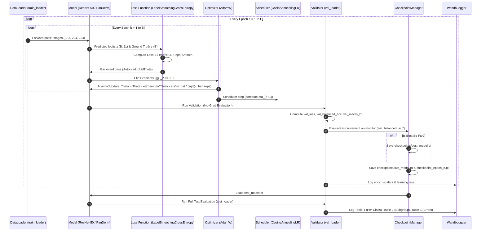

# Complete Training & Optimization Pipeline Explained

**Author**: Senior Machine Learning Engineering & Research Science Reference  
**Project**: SkinCancerTracker / DermaAI  
**Target Audience**: B.Tech CSE / AI Researchers, Faculty Evaluators, Technical Interviewers  
**Specification Version**: Phase 1 & Phase 2 Technical Baseline  

---

## 1. High-Level Training Loop Flowchart

---

## 2. Step-by-Step Mathematical Walkthrough of the Training Step

Every single training step executed in [`src/train/engine.py:17-79`](file:///C:/Users/prtv1/OneDrive/Attachments/Desktop/SkinCancerTracker/src/train/engine.py#L17-L79) follows this rigorous mathematical sequence:

### Step 1: Batch Collation and Hardware Transfer
The DataLoader retrieves a mini-batch of $B=32$ samples:
$$\mathcal{B} = \Big\{ (x_i, y_i, m_i) \Big\}_{i=1}^B$$
where $x_i \in \mathbb{R}^{3 \times 224 \times 224}$ is the augmented, normalized tensor; $y_i \in \{0, \dots, 10\}$ is the diagnostic integer label; and $m_i$ is the demographic metadata dictionary (`isic_id`, `lesion_id`, `skin_tone_class`).
The batch is pinned in host memory and transferred to GPU device memory via asynchronous DMA copy:
$$x \leftarrow x.\text{to}(\text{device}), \quad y \leftarrow y.\text{to}(\text{device})$$

### Step 2: Forward Propagation
The model evaluates the batch:
$$z = f(x; \theta) \in \mathbb{R}^{B \times 11}$$
For ResNet-50:
$$z_i = W_{\text{fc}} \cdot \text{Dropout}\Big( \text{AvgPool}\big( \text{ResNetBackbone}(x_i) \big) \Big) + b_{\text{fc}}$$
For PanDerm ViT:
$$z_i = W_{\text{head}} \cdot \text{LayerNorm}\left( \frac{1}{196} \sum_{p=1}^{196} \text{TransformerEncoder}(x_i)_p \right) + b_{\text{head}}$$

### Step 3: Regularized Loss Calculation
The loss engine executes [`LabelSmoothingCrossEntropy`](file:///C:/Users/prtv1/OneDrive/Attachments/Desktop/SkinCancerTracker/src/losses/classification.py#L11-L32):
$$\mathcal{L}(\mathcal{B}; \theta) = \frac{1}{B} \sum_{i=1}^B \left[ (1 - \epsilon) \cdot \left( -\log \frac{e^{z_{i, y_i}}}{\sum_j e^{z_{i, j}}} \right) + \epsilon \cdot \left( -\frac{1}{11} \sum_{k=0}^{10} \log \frac{e^{z_{i, k}}}{\sum_j e^{z_{i, j}}} \right) \right]$$
where $\epsilon = 0.1$ for PanDerm fine-tuning, and $\epsilon = 0.0$ (reducing to standard cross-entropy) for ResNet-50 baseline.

### Step 4: Gradient Backpropagation via the Multivariable Chain Rule
Before computing new gradients, previously accumulated gradients are zeroed:
$$\text{optimizer.zero\_grad()} \implies \nabla_\theta \mathcal{L} \leftarrow 0$$
Executing `loss.backward()` triggers reverse-mode automatic differentiation:
$$\frac{\partial \mathcal{L}}{\partial \theta_l} = \sum_{j} \frac{\partial \mathcal{L}}{\partial a_j} \cdot \frac{\partial a_j}{\partial \theta_l}$$
For the output classification layer $z = W a + b$:
$$\frac{\partial \mathcal{L}}{\partial z_{i, k}} = p_{i, k} - q_{i, k}$$
where $q_{i, k}$ is the smoothed target distribution and $p_{i, k} = \text{softmax}(z_i)_k$. The error vector propagates back through all lower convolutional or attention layers.

### Step 5: Gradient Norm Thresholding (Clipping)
To prevent destabilizing gradient spikes, the global $L_2$ norm is computed:
$$\|g\|_2 = \sqrt{\sum_{\theta \in \Theta} \|\nabla_\theta \mathcal{L}\|_2^2}$$
If $\|g\|_2 > \tau = 1.0$:
$$\nabla_\theta \mathcal{L} \leftarrow \nabla_\theta \mathcal{L} \cdot \frac{\tau}{\|g\|_2}$$

### Step 6: AdamW Optimization Update
[`torch.optim.AdamW`](file:///C:/Users/prtv1/OneDrive/Attachments/Desktop/SkinCancerTracker/src/train/train_experiment.py#L255) executes the parameter update:
1. Update biased 1st moment estimate:
   $$m_t = \beta_1 m_{t-1} + (1 - \beta_1) g_t \quad (\beta_1 = 0.9)$$
2. Update biased 2nd raw moment estimate:
   $$v_t = \beta_2 v_{t-1} + (1 - \beta_2) g_t^2 \quad (\beta_2 = 0.999)$$
3. Compute bias-corrected moments:
   $$\hat{m}_t = \frac{m_t}{1 - \beta_1^t}, \quad \hat{v}_t = \frac{v_t}{1 - \beta_2^t}$$
4. Apply decoupled weight decay and momentum step:
   $$\theta_t = \theta_{t-1} - \eta_t \lambda \theta_{t-1} - \frac{\eta_t}{\sqrt{\hat{v}_t} + 10^{-8}} \hat{m}_t$$

### Step 7: Cosine Annealing Learning Rate Step
At the end of each epoch, [`torch.optim.lr_scheduler.CosineAnnealingLR`](file:///C:/Users/prtv1/OneDrive/Attachments/Desktop/SkinCancerTracker/src/train/train_experiment.py#L258) adjusts $\eta$:
$$\eta_t = \eta_{\min} + \frac{1}{2}(\eta_{\text{base}} - \eta_{\min})\left( 1 + \cos\left( \frac{t}{T_{\max}} \pi \right) \right)$$
For Exp-1: $\eta_{\text{base}} = 10^{-4}, \eta_{\min} = 10^{-6}, T_{\max} = 30$.  
For Exp-2: $\eta_{\text{base}} = 5 \times 10^{-4}, \eta_{\min} = 10^{-6}, T_{\max} = 30$.

---

## 3. Validation and Checkpoint Selection

Validation occurs at the conclusion of every training epoch:
1. Model is set to evaluation mode (`model.eval()`), disabling dropout and freezing batch normalization running statistics.
2. In a `torch.no_grad()` context, the model processes the $1,572$ validation images.
3. The engine computes `val_loss`, `val_accuracy`, `val_balanced_acc`, and `val_macro_f1`.
4. [`CheckpointManager`](file:///C:/Users/prtv1/OneDrive/Attachments/Desktop/SkinCancerTracker/src/train/checkpointing.py) monitors `val_balanced_acc`:
   $$\text{Is Better? } \iff \text{BalAcc}_{\text{current}} > \text{BalAcc}_{\text{best}}$$
   If true, `checkpoints/<exp_name>/best_model.pt` is overwritten.
   Additionally, `checkpoints/<exp_name>/last_model.pt` and `checkpoint_epoch_<epoch>.pt` are serialized.

---

## 4. Smoke Test Architecture & Watchdog Timer

To prevent training runs from hanging on local or CI environments (especially under Windows multiprocessing restrictions), [`src/train/train_experiment.py`](file:///C:/Users/prtv1/OneDrive/Attachments/Desktop/SkinCancerTracker/src/train/train_experiment.py#L30-L58) implements a dedicated watchdog:

- **`SmokeTestWatchdog`**: A daemon `threading.Timer` initialized with a strict timeout (default: $90.0$ seconds).
- **Execution Constraints**: Sets `epochs = 1`, `max_batches = 2`, `num_workers = 0`, and bypasses background multi-processing.
- **Stage Tracking**: Monitors milestone progression:
  1. `Configuration loaded`
  2. `Dataset loaded`
  3. `Model initialized`
  4. `Batch loaded`
  5. `Forward pass successful`
  6. `Loss calculation successful`
  7. `Exp-1 / Exp-2 smoke test passed`
- If any phase blocks (e.g. CUDA deadlocks, unhandled file locks), the watchdog triggers `os._exit(1)`, cleanly reporting the stalled pipeline stage.
